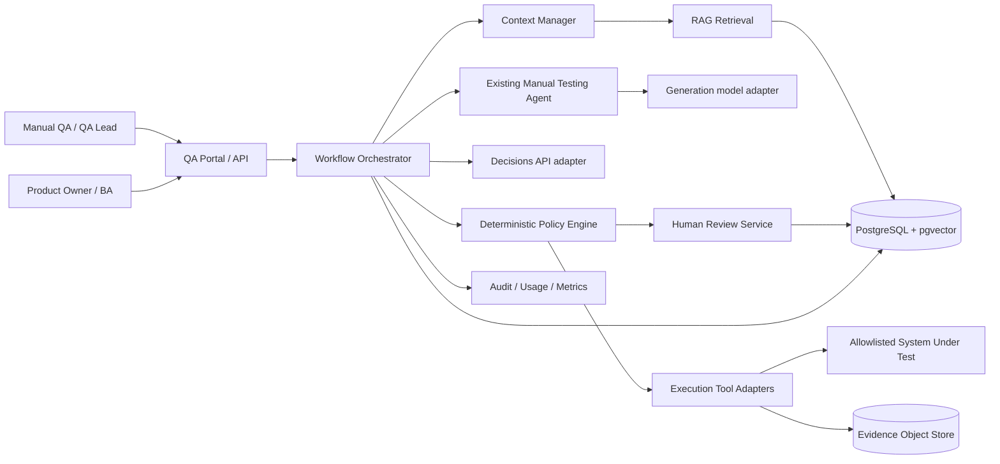

# 02 — System architecture

**Status:** Proposed · **Pattern:** Modular monolith first, separable providers later

## Context diagram



**Trust boundaries:** user inputs, source documents and the system under test are untrusted; execution credentials and review privileges are controlled; model output is advisory; policy engine is authoritative for permission.

## Component responsibilities

| Component | Responsibility | Must not do |
| --- | --- | --- |
| API/UI | Authenticate, authorize, present sources and reviews | Trust client-side role flags |
| Workflow orchestrator | Persist lifecycle, route tasks, make actions idempotent | Equate LLM text with authorization |
| Context manager | Select relevant source IDs, trim input within budget | Stuff all documents in every prompt |
| RAG adapter | Retrieve by metadata + semantic/full-text ranking | Auto-promote unverified knowledge |
| Existing agent adapter | Propose tests/actions, consume approved evidence | Write to external systems without policy |
| Decisions adapter | Return typed probabilistic readiness/risk/triage | Set test PASS/FAIL or permissions |
| Policy engine | Enforce environment, action, approval, evidence and budget rules | Depend only on confidence score |
| Execution adapters | Browser/API/DB checks, deterministic assertions | Run outside configured allowlists |
| Review service | Human clarify/approve/reject/escalate | Implicitly approve expired requests |
| Evidence store | Secure screenshots, traces and logs | Pass raw evidence to model by default |
| Observability | Usage, trace and audit logs | Log secrets or full customer content |

## Code layout

```text
apps/
  api/                     # HTTP API + API-key auth (implemented)
  cli/                     # migrate, seed, ingest, revoke, eval (implemented)
  mcp/                     # Propose-only MCP tool server for AI clients, AI_AGENT key only (implemented; ADR-0011)
  reviewer-ui/             # Optional web review queue (planned)
  worker/                  # Test-run worker with leases (implemented)
  demo-sut/                # Demo system under test + executable specs (pilot/CI only)
packages/
  domain/                  # Contracts, state machines, redaction (implemented)
  db/                      # Migrations + tenant-scoped repositories, PostgreSQL/PGlite (implemented)
  orchestrator/            # Workflow routing, persisted resumable steps (implemented)
  retrieval/               # Ingestion, full-text + exact-ID search, context budgets (implemented)
  llm-adapter/             # Claude readiness + drafts, grounding checks (implemented; ADR-0004)
  policy-engine/           # Deterministic action gate (implemented)
  review/                  # Human review, approvals, draft lifecycle (implemented)
  observability/           # Structured logging with redaction (implemented)
  execution/               # Playwright executor, constrained steps (implemented; ADR-0008)
  evidence/                # Evidence store port + local-disk adapter (implemented)
  integrations/            # Jira Cloud bug tracker adapter (implemented; ADR-0009)
eval/                      # Labeled pilot fixtures
```

The separate `decisions-adapter` was folded into `llm-adapter` when Claude replaced the Decisions API (ADR-0004).

**Start as a modular monolith:** one deployable API + worker (can share repository), one PostgreSQL, one object store; split services only after scaling evidence. Use dependency injection via interfaces so existing agent logic can be wrapped rather than rewritten.

## Orchestrator contract (conceptual)

```ts
type NextAction =
  | { type: 'GENERATE_DRAFT'; contextIds: string[] }
  | { type: 'EXECUTE_APPROVED'; caseId: string; approvalId?: string }
  | { type: 'REQUEST_REVIEW'; reason: string; sourceIds: string[] }
  | { type: 'STOP'; reason: string };

interface PolicyEngine {
  authorize(action: NextAction, context: ExecutionContext): Promise<PolicyResult>;
}
```

LLM/Decisions output is converted into a proposed `NextAction`; **the policy engine validates it** before it becomes an executable command.

## Failure handling

- RAG no match: request clarification or bounded retry with alternative query; never assume absent rule means no rule.
- Decisions refusal/error/timeout: mark readiness unknown and request review or use approved deterministic rule.
- Agent malformed output: fail schema validation; do not dispatch tool call.
- Executor timeout: mark run `INCONCLUSIVE`; attach partial evidence and retry only with idempotency checks.
- Object store unavailable: stop execution if mandatory evidence cannot be preserved.
- Lost worker lease: recover from persisted state; deduplicate actions by operation key.

## Cross-cutting design

Every task carries `tenantId`, `projectId`, `workflowId`, `traceId`, `environmentId`, `policyVersion`, `knowledgeSnapshotId`, and a scoped actor identity. Reference [security](09-security.md) and [data contracts](07-data-contracts.md).
