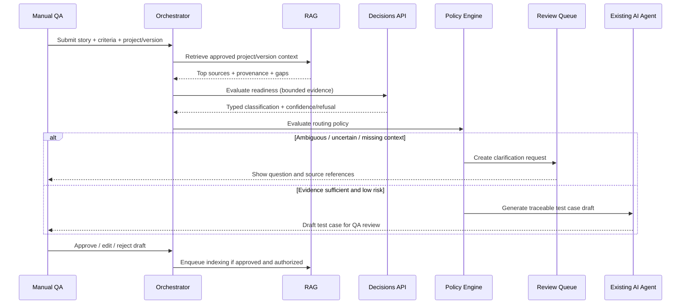
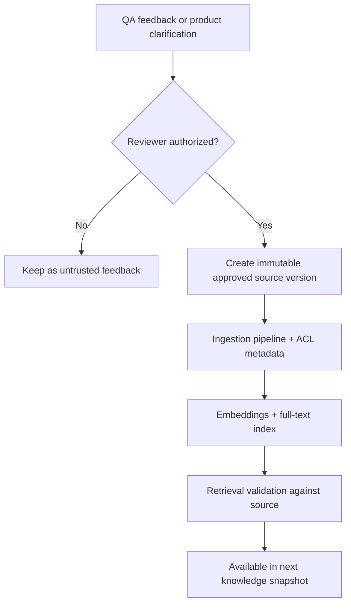

# 03 — End-to-end workflows and state transitions

**Status:** Proposed

## Workflow A — Review user story and generate manual test drafts (MVP)



### Required output

- Story/AC IDs, selected source IDs/versions, retrieval confidence information.
- Test title, priority suggestion, test preconditions, data needs, steps and expected outcomes.
- Explicit assumptions and missing requirements, not silent guesses.
- Cost/usage and policy trace ID.

## Workflow B — Authorized test execution (P1)

> Implemented in Phase 2 (ADR-0008). The approved case first gets an approved executable spec. Sensitive runs end `BLOCKED` with an `ACTION_APPROVAL` review. After approval, the run is requested again with the `approvalId`, and the worker re-checks it right before executing.

1. QA selects an **approved case** and environment.
2. Orchestrator checks role, environment/domain allowlist, impact class and test-data policy.
3. If a sensitive action is proposed, orchestrator creates a review request tied to `actionHash`, `environmentId`, test ID and expiry.
4. Upon valid approval, executor performs steps with allowlisted browser/API tools.
5. Assertions check actual facts against approved expectations; attach logs and screenshots.
6. Runner records its own `PASSED`, `FAILED`, `BLOCKED`, `INCONCLUSIVE` verdict.
7. Decisions API optionally labels *suspected cause* on inconclusive/failed evidence, never changes the verdict.
8. Human verifies security-critical, contradictory or uncertain findings before external bug filing.

## Workflow C — Knowledge feedback (MVP)



**Never** write autonomous agent summaries directly to a trusted knowledge collection.

## Separate lifecycle state machines

### Test case definition

```text
DRAFT -> NEEDS_CLARIFICATION -> DRAFT
DRAFT -> IN_REVIEW -> APPROVED -> RETIRED
IN_REVIEW -> REJECTED -> DRAFT
```

`APPROVED` is a human-approved **test definition**, not evidence that it passes.

### Execution run

```text
QUEUED -> POLICY_CHECK -> RUNNING -> PASSED | FAILED | BLOCKED | INCONCLUSIVE
POLICY_CHECK -> BLOCKED
RUNNING -> CANCELLED | INCONCLUSIVE
```

A definitive assertion can fail automatically. `FAILED` denotes observed failure against approved expected behavior, not a confirmed product defect.

### Human review

```text
OPEN -> ASSIGNED -> APPROVED | REJECTED | NEEDS_INFO | CANCELLED
NEEDS_INFO -> ASSIGNED
```

A review record applies to a specific question/action, not the entire future project. Approval expiry/revocation must be checked at use time.

## Example: ambiguous account lockout rule

AC: "After multiple failed logins, the system locks the user out."

- RAG returns login policy, but no approved numeric limit.
- Readiness classification suggests `NEEDS_CLARIFICATION`.
- Review asks Product Owner: "How many consecutive failed attempts trigger lockout; how long does it last?"
- Reviewer updates approved specification.
- Re-indexed rule enables valid test designs for exact limits and reset behavior.

## Example: UI success message but failed DB write

- Browser shows "Saved".
- API call returned 2xx but DB verification shows no persisted item after an agreed consistency window.
- Deterministic checks record a failure/contradiction with timestamps.
- Decisions API may label suspected cause; this is **not** proof of backend bug.
- Review gathers environment/data consistency context and decides whether to file a defect.
