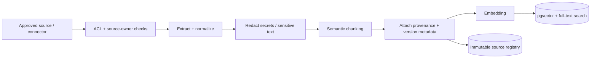

# 04 — RAG, knowledge provenance and token management

**Status:** Proposal · **MVP objective:** Ground agent recommendations in trusted project knowledge without bloating prompts.

## Why RAG?

RAG adds specific approved business context that the agent cannot know reliably from its base model. It **may** save input tokens when compared with sending all documents, but additional retrieval calls, embeddings and tool outputs also cost resources. Measure net cost, precision and task outcome quality.

## Knowledge sources and trust tiers

| Source | Trust tier | Rules |
| --- | --- | --- |
| Approved AC / specification | T1 | Versioned source of business expectations |
| Reviewed QA test cases | T1 | Approved tests, not proof implementation is correct |
| Reviewed product clarifications | T1 | Require authorized business/QA source owner |
| Approved API contracts | T1 | For an identified application release |
| Historical bug reports | T2 | Historical observation only; never a current requirement |
| Test logs, screenshots, chat excerpts | T3 | Evidence scoped to run; untrusted until reviewed |
| AI-generated drafts and freeform summaries | T4 | Never auto-index as trusted knowledge |

Default test-generation prompts include T1; T2 may inform edge cases; T3 can inform triage but not expected behavior; T4 is excluded from trusted answers.

## Ingestion pipeline



### Metadata required on every chunk

`tenant_id`, `project_id`, `source_id`, `source_version`, `source_type`, `approval_status`, `approved_by`, `owner`, `product_area`, `release_version`, `environment_scope` (if relevant), `language`, `created_at`, `effective_from`, `expires_at` (optional), `content_hash`, `chunk_index` and `access_policy`.

Use precise numeric/identifier matching and hybrid keyword search for business rule numbers, AC IDs, error codes and endpoint paths. A nearest vector match alone may incorrectly substitute another project's policy.

## Retrieval pipeline

1. Identify project/tenant and user authorization from authenticated session, not prompt text.
2. Parse request type (`GENERATE_TEST`, `CLARIFY_AC`, `TRIAGE_FAILURE`).
3. Choose trust tiers and metadata filters (`approved=true`, product/release context).
4. Run hybrid lexical + vector search and merge/dedupe.
5. Rerank small candidate pool using source relevance, freshness and trust tier (LLM reranking optional).
6. Expand neighboring chunks **only if** evidence would otherwise lose the relevant clause.
7. Detect contradictory source versions; preserve both and route conflicts to review.
8. Apply context budget and include citations to exact source/version/chunk.
9. Return `NO_TRUSTED_CONTEXT` if no valid source exists; never fabricate rules.

## Chunking strategy (starting heuristics to validate)

- Requirements: one AC/business rule group per chunk, maintaining headings and enumerations.
- API specs: endpoint + method + validations + response schema as one logical unit where possible.
- Prior test cases: scenario and its expected result together.
- Use token-aware chunks of roughly 300–700 tokens with restrained overlap (e.g. 50–100) when semantic boundaries permit. **Tune against retrieval evals** instead of assuming universal optimal sizes.
- Store documents and evidence by reference outside vector DB; embeddings index text + pointers.

## Context budget manager

Example **starting** budget for a single readiness check, subject to measurement:

| Context component | Soft budget (tokens) |
| --- | ---: |
| Policy/task instructions | 500 |
| Current story / AC | 600 |
| Retrieved approved sources | 1,800 |
| Condensed prior state | 300 |
| Reserve and metadata | 300 |
| **Illustrative input ceiling** | **3,500** |

Rules: prefer latest authorized exact AC; drop redundant results; trim T2 first, then T1 chunks matched only by shared keywords (each recorded as a gap, ADR-0010); never truncate inside a chunk. If an exact-ID match cannot fit, split into separate focused subtasks or ask for review. The budget controls *retrieved context*, not necessarily the complete provider token usage.

## Retrieval interface (proposed)

```ts
type EvidenceChunk = {
  sourceId: string;
  version: string;
  chunkId: string;
  content: string;
  trustTier: 'T1' | 'T2' | 'T3' | 'T4';
  relevance: number; // Retriever-specific ranking signal; not correctness probability
};

type RetrievalResult = {
  chunks: EvidenceChunk[];
  snapshotId: string;
  usedTokensEstimate: number;
  gaps: string[];
  contradictions: Array<{ first: string; second: string }>;
};
```

## Cache design

- Cache key includes tenant, project, caller permissions, query type, source snapshot, prompt/policy version and retrieval configuration.
- Invalidate when approved knowledge, ACL or source versions change; TTL alone is insufficient for revocation.
- Cache only de-identified/non-sensitive derived data consistent with data policy.
- Always enforce authorization before returning a cached response.

## Feedback and learning loop

Human approval creates a **new immutable version** of a trusted source; ingestion validates source ownership and re-indexes it. Rejected drafts remain in history for analytics but are not promoted. Use reviewer feedback to improve retrieval ranking and evaluation sets without treating model output as ground truth.

## RAG evaluation cases

- Exact source known: retrieves correct AC/version in top-k.
- Same feature in multiple tenants: never leaks cross-tenant results.
- Old and new policy conflict: highlights conflict, never silently chooses obsolete rule.
- No source: detects knowledge gap rather than creating a rule.
- Prompt injection embedded in a source: ignored and not executed.
- Token budget exceeded: context reduced safely or workflow blocked.
