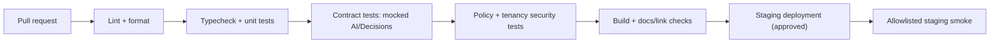

# 11 — Development, deployment and operational guidance

**Status:** Local and CI setup implemented (Phases 1–3); no shared environment has been deployed.

## Local developer setup (target state)

- Node.js runtime with supported TypeScript tooling, pinned by `.nvmrc` or `.tool-versions` when code is created.
- PostgreSQL with `pgvector` extension (or a separately selected vector store).
- S3-compatible object storage (local-compatible mock permitted for development).
- Environment-specific secret injection for `OPENAI_API_KEY`, DB credentials, evidence storage and test application accounts.
- Playwright only if browser execution is within the pilot scope.

The repository provides `env.example` (names only), `docker-compose.yml` (PostgreSQL + pgvector), `pnpm db:migrate`, `pnpm qa seed`, seed sources in `eval/fixtures/sources`, `pnpm eval`, and `.github/workflows/ci.yml`. Without `DATABASE_URL` an embedded PGlite database is used, so local development and tests need no Docker.

PGlite serializes every query, so it cannot reproduce concurrency between connections or processes. The `verify` job runs the suite on PGlite. A second CI job, `postgres`, runs the same suite against a `pgvector/pgvector:pg17` service: setting `QA_TEST_DATABASE_URL` makes each test file create and drop its own database on that server. A double-claim mutant of `claimNextRun` (no `FOR UPDATE SKIP LOCKED`) passes on PGlite but fails on PostgreSQL. Locally:

```bash
docker run -d --name qa-pg -e POSTGRES_USER=qa -e POSTGRES_PASSWORD=<local> -p 127.0.0.1:55432:5432 pgvector/pgvector:pg17
QA_TEST_DATABASE_URL=postgres://qa:<local>@127.0.0.1:55432/qa pnpm test
```

The production layout was verified locally on 2026-10-14. The API and two separate `pnpm worker` processes shared PostgreSQL 17 and four concurrently queued runs. Each run was claimed and executed exactly once (one `RUN_START`/`RUN_FINISH` each, split 2/2 across the workers). Downloaded evidence matched its stored digest.

## Environments

| Environment | Allowed use | Restrictions |
| --- | --- | --- |
| Local | Mocked providers, fixtures and replay | No real customer data |
| CI | Unit/contract/integration tests | Live AI provider disabled by default |
| Staging | End-to-end approved smoke tests | Synthetic accounts/data, strict allowlists |
| Production | Reviewer workflow and authorized service calls | Test execution writes disabled by default |

## Suggested CI pipeline



## Deployment architecture

One API deployment, one worker process, one managed relational database, one object store and a secret manager are sufficient to start. Queue infrastructure may be introduced when tasks need durable concurrency and retry semantics. Don't create microservices solely because some components use AI.

## Release safety checklist

- [ ] Database migrations backward-compatible or rollback plan provided
- [ ] Policy config and target environment allowlists reviewed
- [ ] Secrets loaded from secret manager; none committed to Git
- [ ] Evidence bucket private; signed URL expiry and ACL tested
- [ ] RAG filters and source version tests pass
- [ ] AI provider failures/refusals route safely
- [ ] AI provider model ID, SDK version and response shape re-verified against current provider docs
- [ ] Approval expired/replay tests pass
- [ ] Model, prompt, source index and policy versions pinned/logged
- [ ] Feature flags allow immediate disablement of execution and provider calls
- [ ] Observability and usage budget alerts functional

## Operational playbooks

### Provider outage

Disable live decisions if necessary; use deterministic checks where valid; route judgment-requiring tasks to review. Never bypass permissions. Backfill classification only if tasks remain relevant and idempotent.

### Bad source indexed

Revoke source, invalidate cache and vector records, rebuild index, flag dependent drafts/runs for review and preserve audit trail.

### Suspected unsafe agent action

Stop worker/execution flag, revoke temporary credentials, preserve audit/evidence, identify affected action hashes and perform an authorized incident review.

### Token/cost spike

Rate-limit workflows and provider calls; inspect high-volume step types and retrieval sizes; adjust per-step budgets without weakening audit or security controls.
